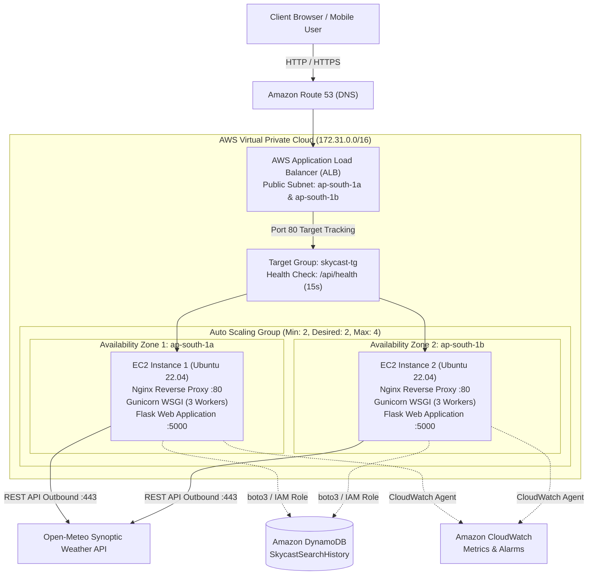

# SKYCAST — AWS Cloud Architecture Specification

## 1. Executive Summary

**SKYCAST** is engineered as a cloud-native, highly available, fault-tolerant meteorological monitoring and intelligence platform. It demonstrates modern enterprise cloud architecture principles including decoupled compute tiers, horizontal scalability, automated health verification, and secure instance metadata retrieval.

---

## 2. High-Availability Multi-Instance Cloud Architecture Diagram

---

## 3. Component Deep Dive

### 3.1 Application Load Balancer (ALB)
- **Layer 7 Load Balancing**: Inspects HTTP requests and routes traffic using round-robin distribution to healthy EC2 instances across multiple Availability Zones (`ap-south-1a` and `ap-south-1b`).
- **Health Checking**: Continuously polls `GET /api/health` every 15 seconds. If an instance fails 3 consecutive checks (unhealthy threshold), it is automatically removed from active routing without dropping user sessions.
- **SSL Termination**: Offloads TLS computation at the load balancer level, passing clean HTTP traffic to backend compute nodes.

### 3.2 Auto Scaling Group (ASG)
- **Elastic Capacity**: Dynamically responds to demand surges.
  - **Min Size**: 2 instances (maintaining high-availability across 2 AZs).
  - **Desired Size**: 2 instances.
  - **Max Size**: 4 instances.
- **Target Tracking Policy**: Automatically provisions an additional EC2 instance if average CPU utilization exceeds **70%** for 3 minutes, and cools down when traffic subsides.

### 3.3 EC2 Compute Nodes (Ubuntu 22.04 LTS)
- **Nginx Reverse Proxy**: Listens on port 80, directly serves static assets (CSS, JS, SVG images) with aggressive client caching (`Cache-Control: 7d`), and acts as a high-speed reverse proxy to Gunicorn.
- **Gunicorn WSGI Server**: Runs 3 asynchronous pre-fork worker processes (`(2 x CPU Cores) + 1`), managing Python execution and protecting against slow client attacks.
- **Flask Application**: Handles API routing, weather data transformations, and template serving.

### 3.4 EC2 Instance Metadata Service Version 2 (IMDSv2)
- **Security Standard**: IMDSv2 requires a session-oriented token request with a Time-To-Live (TTL) header (`X-aws-ec2-metadata-token-ttl-seconds: 60`).
- **SSRF Defense**: Completely eliminates Server-Side Request Forgery vulnerabilities that affected IMDSv1 by rejecting requests that lack the negotiated token.
- **Graceful Fallback**: When run outside AWS (e.g. locally on Windows), the app times out in <1s and seamlessly identifies the runtime as **LOCAL DEVELOPMENT MODE**.

### 3.5 Amazon DynamoDB (Optional Cloud State)
- Fully managed NoSQL table (`SkycastSearchHistory`) holding query audit history with single-digit millisecond latency.
- Partition key: `id` (String).
- Read/write access authenticated via IAM Instance Profile without hardcoding AWS Access Keys in code.
