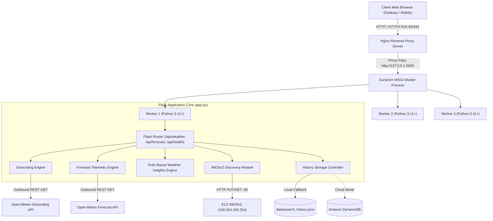
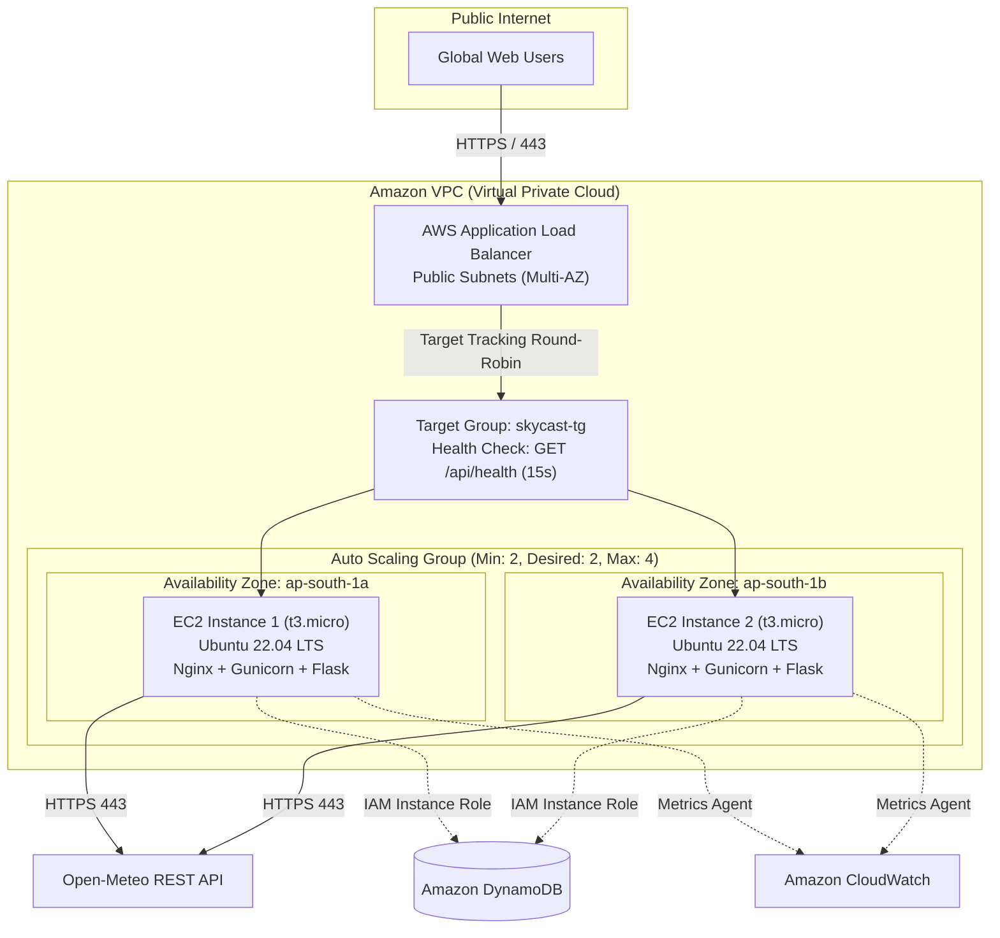
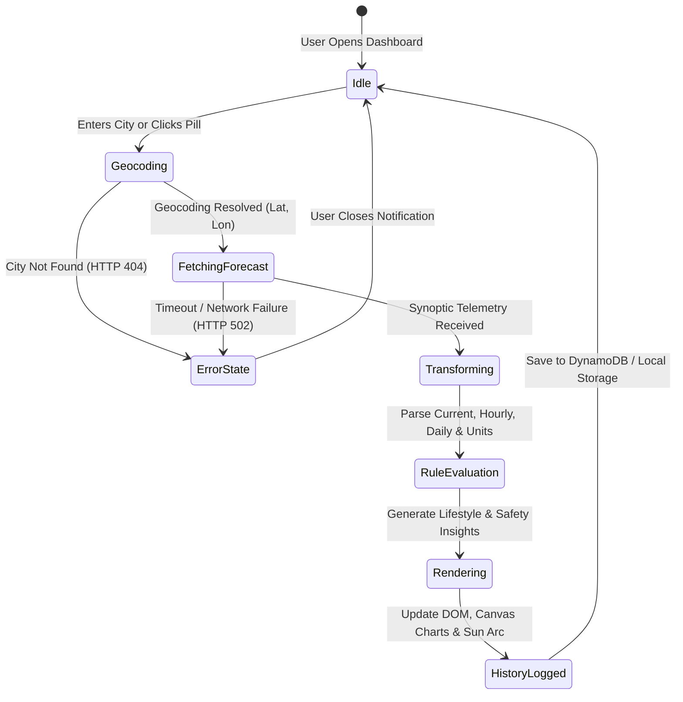

# SKYCAST — System Architecture & Data Flow Diagrams

## 1. High-Level System Architecture Diagram

---

## 2. AWS Multi-EC2 High-Availability Deployment Diagram

---

## 3. Application State & Workflow Diagram

